# Bench Reference Images Gallery

Central media directory for `JayBenjamin/HM3-Battery-Research`. All bench photos are stored here as compressed `.jpg` files and embedded across the repository documentation. *(Click any thumbnail to view full resolution.)*

---

## 1. Surplus Thoratec 102515 Donor Packs

| Donor 3 — `ML031100` (2011, Rev. F) | Donor 4 — `MP143287` (2015, Rev. J) | Donor 1 — `MP181820` (2015, Rev. J) | Donor 2 — `SQ354404` (2016, Rev. J) |
| :---: | :---: | :---: | :---: |
| 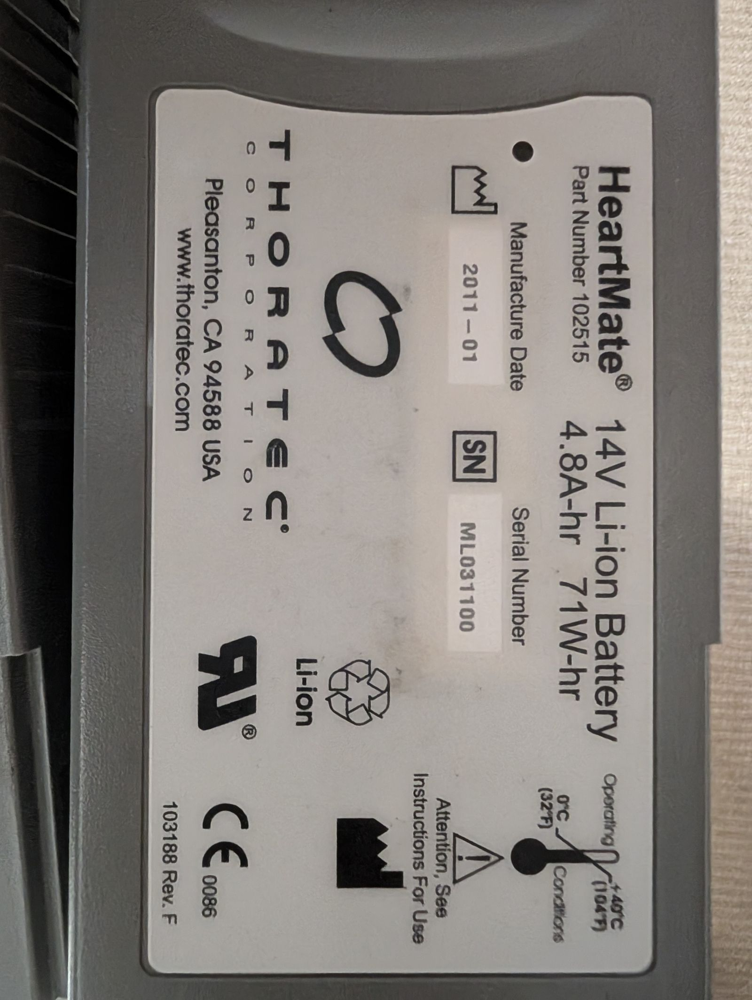 Primary teardown target | 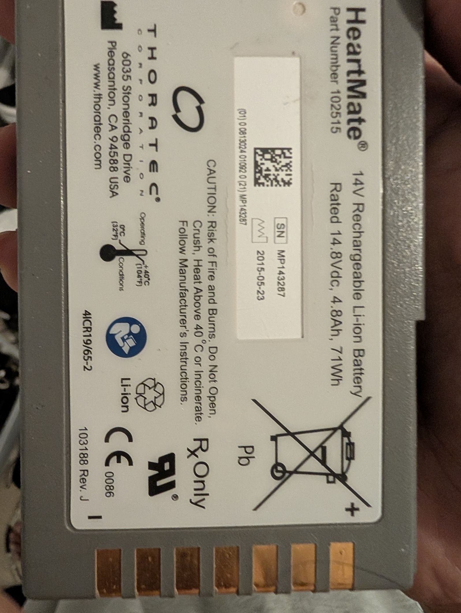 Label & 7-pad gold edge array | 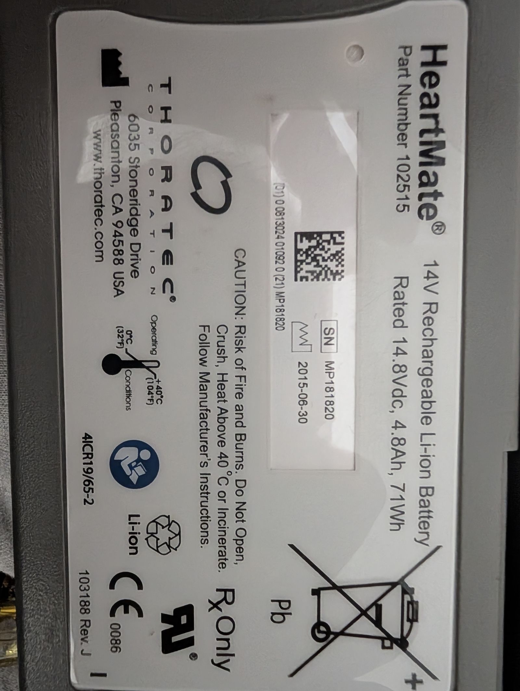 Intact Rev. J reference | 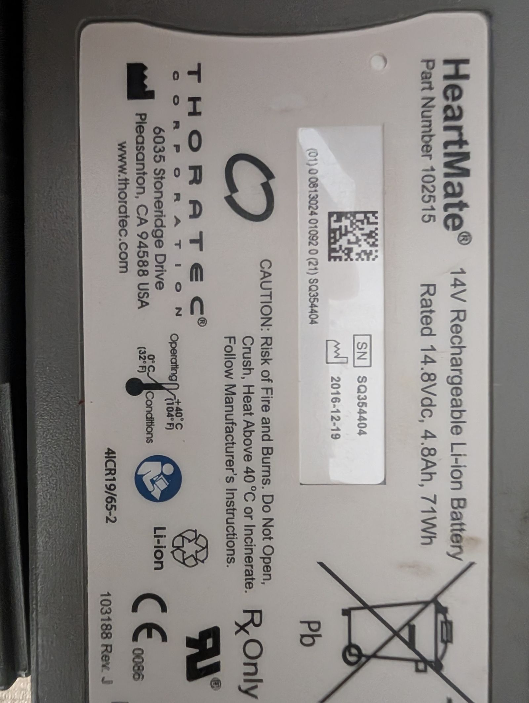 Intact Dec 2016 reference |

---

## 2. Model 2865 Battery Clip (5-Pin Port & 7-Blade Bay)

| Circular Port (Wide) | Circular Port (Macro) | Internal 7-Blade Bay (Wide) | Internal 7-Blade Contacts (Macro) |
| :---: | :---: | :---: | :---: |
| 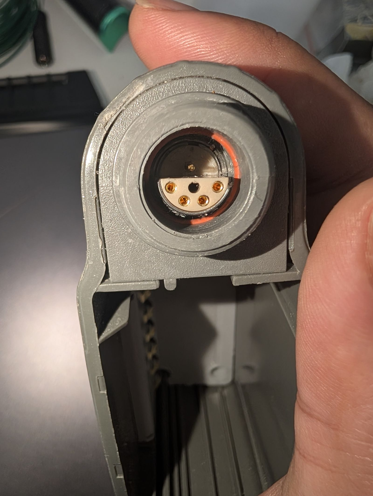 D-keyed shell & orange O-ring | 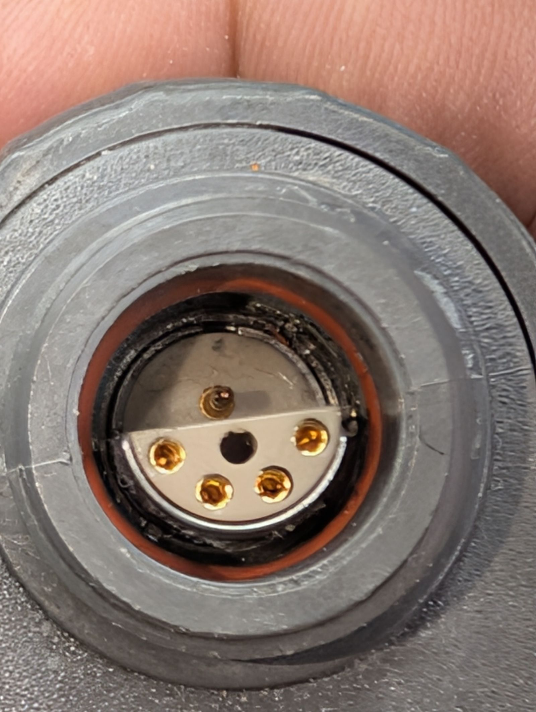 1 top male pin + 4 bottom sockets | 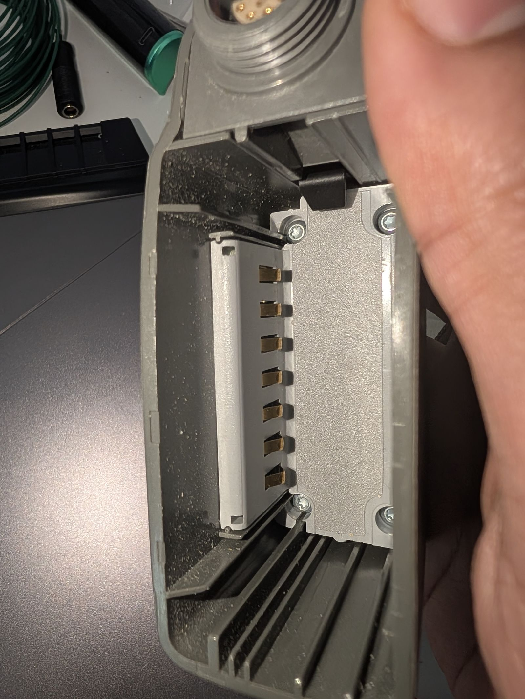 7-blade bay & Torx fasteners | 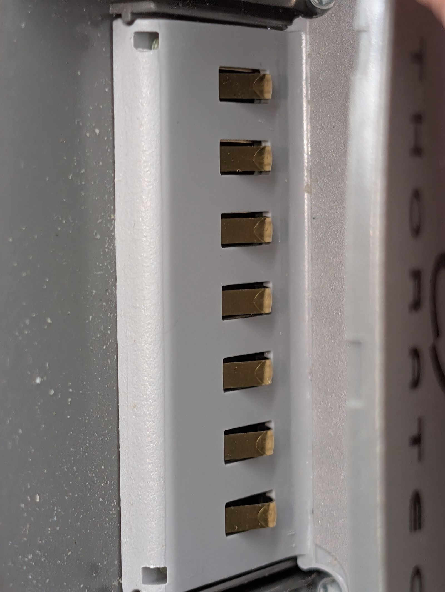 7 gold spring blades |

---

## 3. Mobile Power Unit (MPU) Dual-Port Connectors

| Dual Port Housing (White & Black) | White Port (Macro) | Black Port (Macro) |
| :---: | :---: | :---: |
| 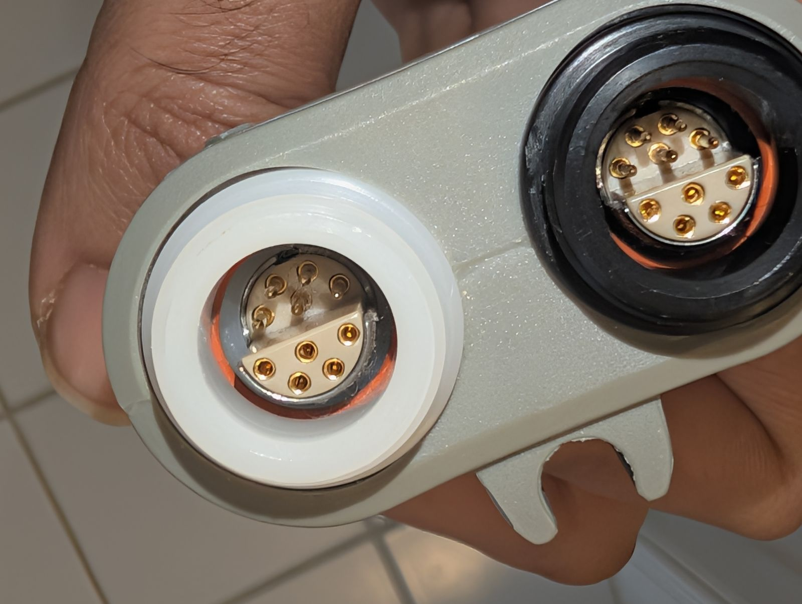 Side-by-side D-keyed ports | 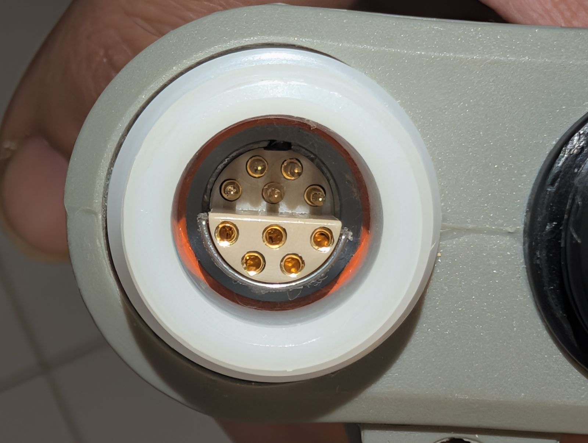 5 top male pins + 5 bottom sockets | 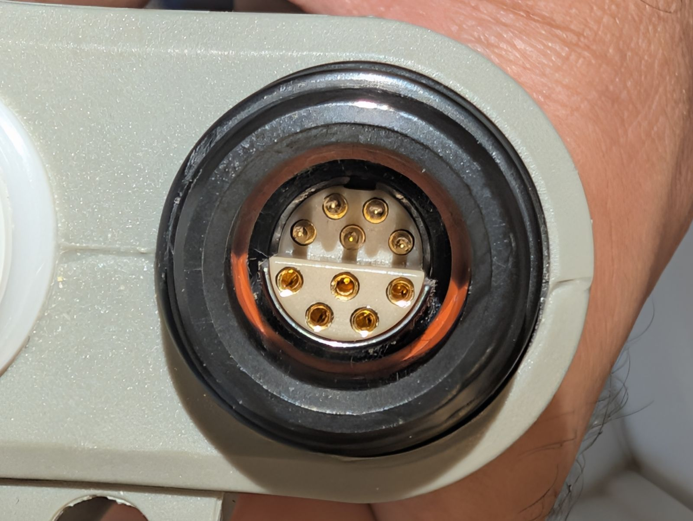 5 top male pins + 5 bottom sockets |

---

## 4. Target 21700 Prototype Cells

| Samsung `INR21700-50G` (`SAMSUNG SDI 2M32`) |
| :---: |
| 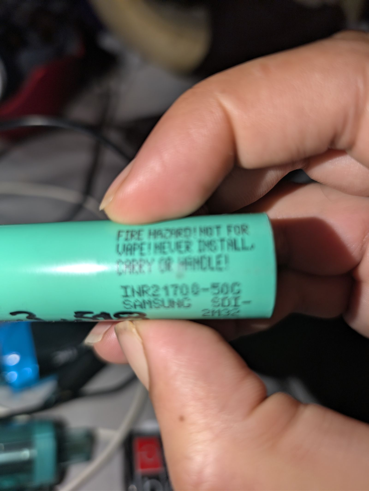 5,000 mAh baseline cell (3.518V resting shipping voltage) |

---

*Note: Convert raw `.dng` captures to compressed `.jpg` or `.webp` (<2 MB, EXIF/GPS stripped) before committing to this folder. Host videos externally (YouTube or GitHub Issue assets) and link them from Markdown.*
