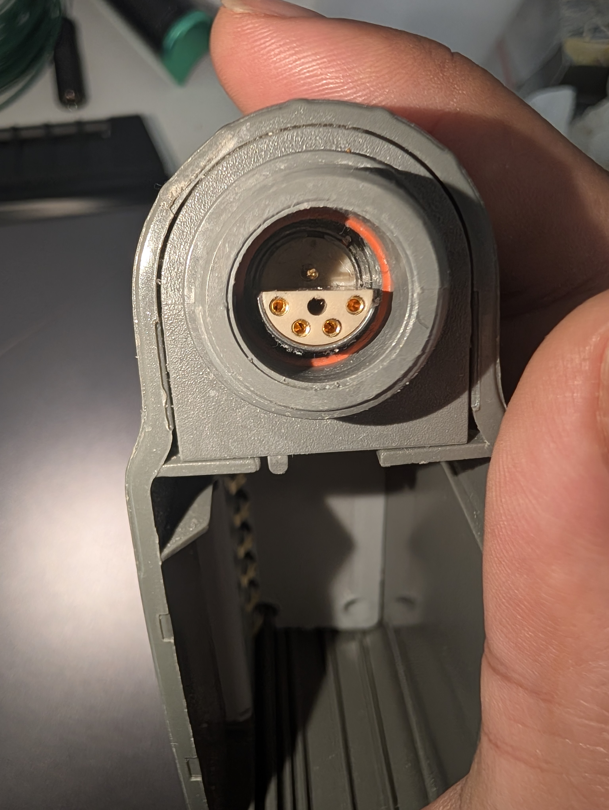
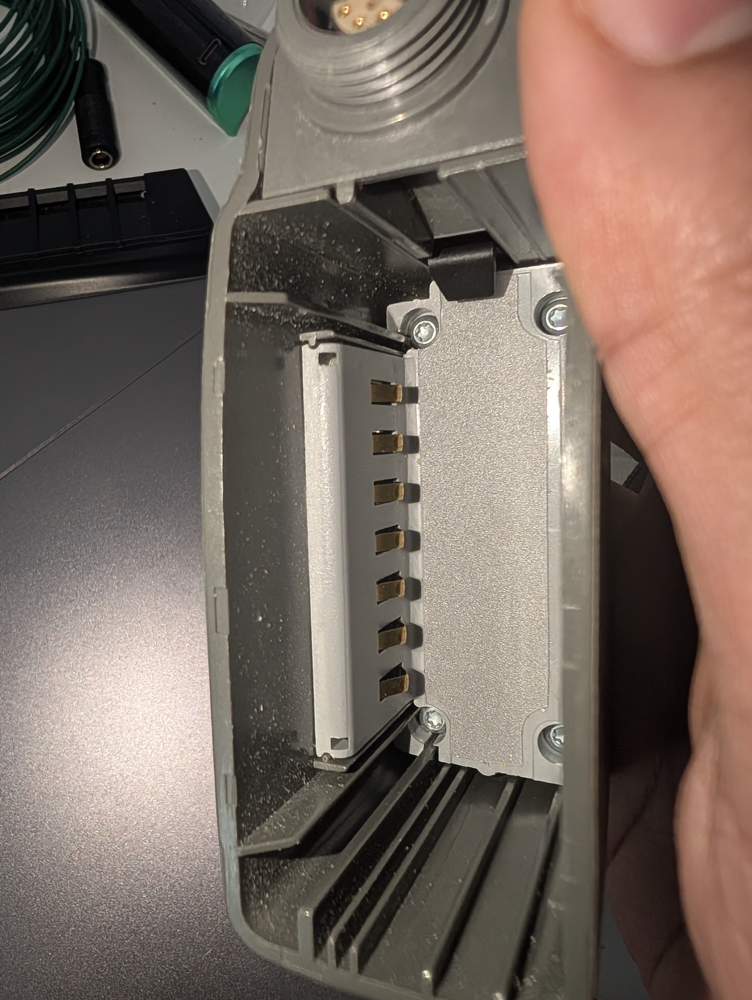
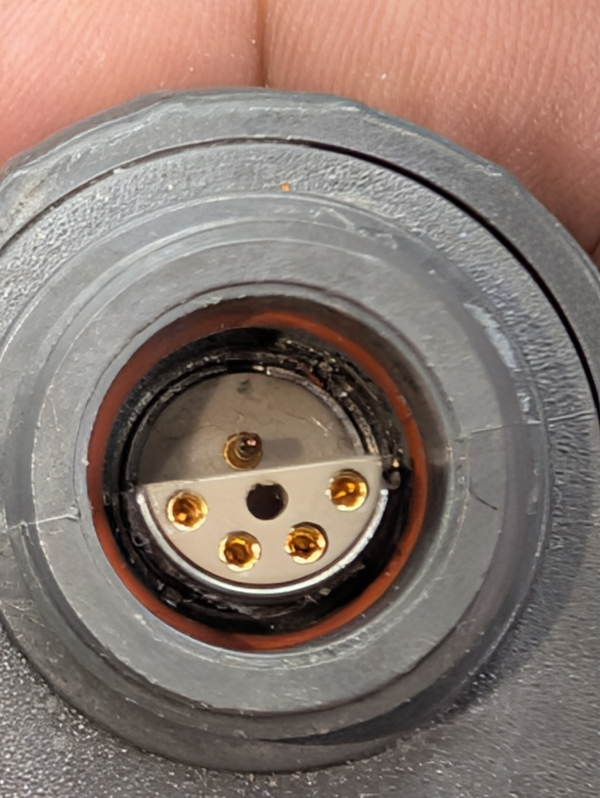
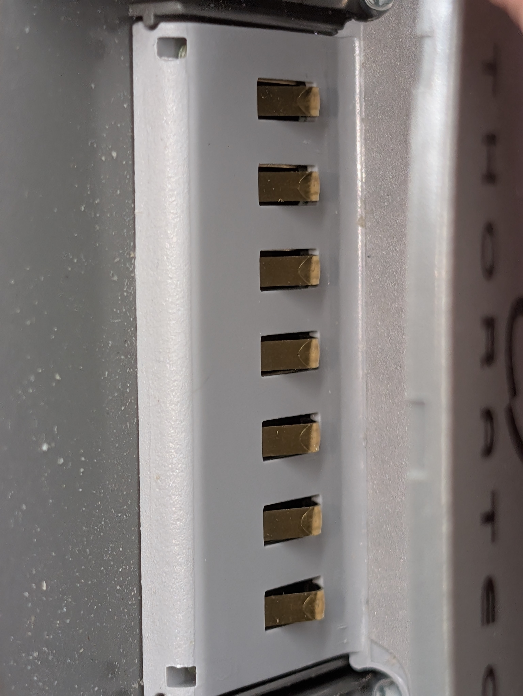

# Model 2865 14V Battery Clip — Connector & Continuity Log

**Status:** In Progress (Milestone 2 — Visual Inspection Only; Electrical Continuity Testing Pending)

## 1. Verified Physical Findings
- **Circular Cable Port:** Uses the same **10-position D-keyed circular shell** and orange O-ring seal as the Mobile Power Unit (MPU) power leads.
- **Populated Contacts (5 of 10):** Only **1 male pin** (top center) + **4 female sockets** (bottom row; bottom-center socket unpopulated) are populated.
- **Comparison vs. MPU Connector:** While the MPU cable populates the upper half of this same connector shell for full telemetry/data, the Model 2865 battery clip leaves the upper half mostly unpopulated—indicating it passes main power and basic low-power/sense signaling rather than full MPU telemetry.
- **Internal Battery Bay:** Features **7 gold spring-loaded blade contacts** that align directly with the 7 gold edge pads on the `Thoratec 102515` battery pack (housing secured by Torx security fasteners).

---

## 2. Reference Photos

*(Click any photo to view full resolution.)*

| Circular Cable Port (Wide View) | Internal 7-Blade Bay (Wide View) |
| :---: | :---: |
|  D-keyed shell, orange O-ring & 5 populated contacts |  7-blade contact array & internal bay housing |
| **Circular Cable Port (Macro)** | **Internal 7-Blade Contacts (Macro)** |
|  1 top-center male pin + 4 bottom female sockets |  Close-up of 7 gold blades mating to 102515 pads |

---

## 3. Next Bench Step
- [ ] **Non-Invasive Continuity Sweep:** Probe continuity between the **7 gold blades inside the clip bay** and the **5 populated circular pins** to map which battery pads route to the System Controller (especially the lone top-center male pin) versus which pads communicate only with the Universal Battery Charger (`UBC`).