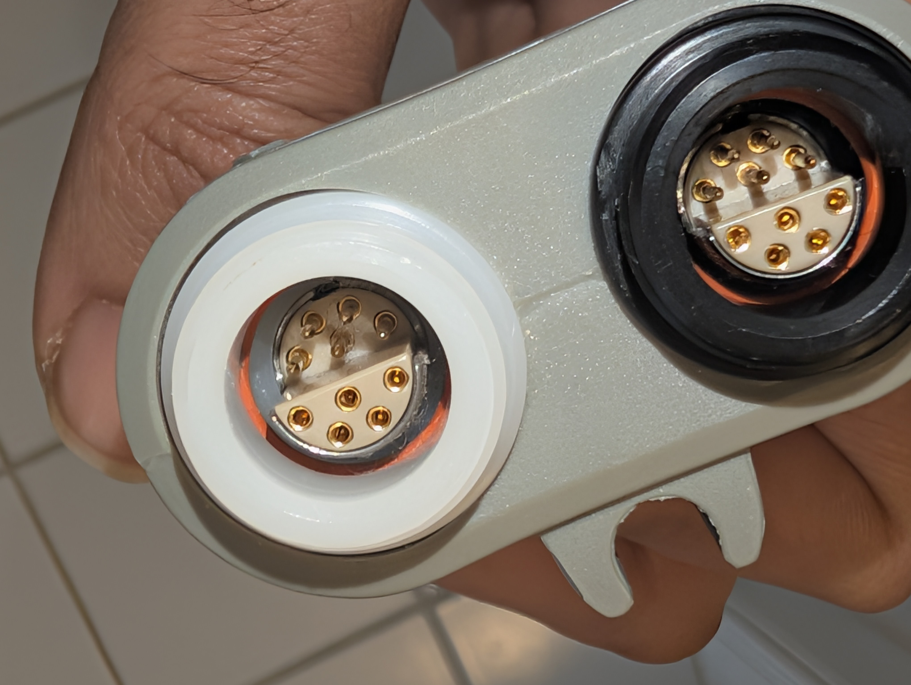
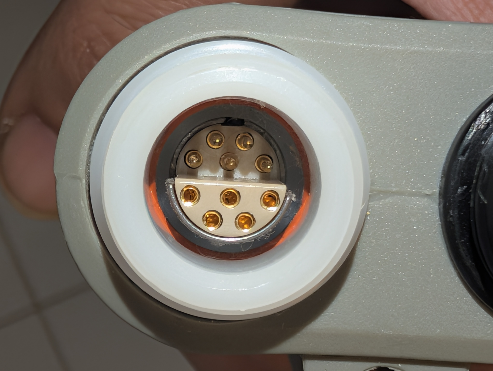
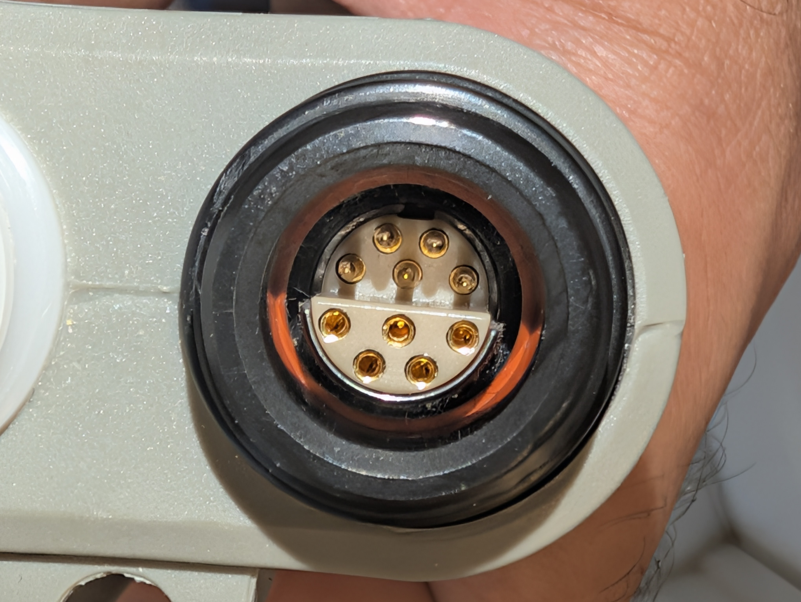

# Mobile Power Unit (MPU) — Connector, Power Baseline & Teardown Plan

**Status:** In Progress (Milestone 2 → Milestone 3)

## 1. Verified Physical Findings
- **MPU Leads (Black & White Cables):** Fully populated **10-pin D-keyed circular connectors** with orange O-ring seals (**5 male pins** on the top half, **5 female sockets** on the bottom half).
- **Color-Coded Port Housing:** Both the White and Black leads share identical 10-pin contact geometry inside the dual-port housing, contrasting with the Model 2865 battery clip (which populates only 5 of the 10 positions).

---

## 2. Reference Photos

*(Click any photo to view full resolution.)*

| Dual Port Housing (White & Black) | White Port (Macro) | Black Port (Macro) |
| :---: | :---: | :---: |
|  Side-by-side White & Black D-keyed ports |  5 top male pins + 5 bottom female sockets |  5 top male pins + 5 bottom female sockets |

---

## 3. Empirical AC Power Consumption Baselines (`4,900 RPM`)
Measured via AC WiFi Watt Meter (full context in the companion [HeartMate 3 Power Survival Guide](https://jbbenjamin.com/heartmate-3-power-survival-guide-solutions-for-lvad-emergencies-off-grid-living/)):
- **MPU Steady-State Average:** `6.47 W` (typical operating range `5.48 W – 7.46 W` at `~117 V`, `0.08 – 0.09 A`).
- **MPU Initial Connection Spike:** `10.15 W` (topping off System Controller internal `11V` backup battery).
- **MPU Idle (Disconnected):** `0 W` measurable.
- **UBC (`Cat. 1440`, 4 Packs from ~40%):** `156.89 W` peak (30–45 min bulk phase), `~74.4 W` cycle average over ~2 hr 35 min (`~192 Wh`), `10–12 W` idle draw.

---

## 4. Next Bench Step
- [ ] **Surplus MPU Teardown (Milestone 3):** Open a decommissioned surplus MPU to trace all 10 circular connector pins (power rails, wall-power presence sense, alarm lines, and serial/UART data) to inform the `4S1P` telemetry architecture.