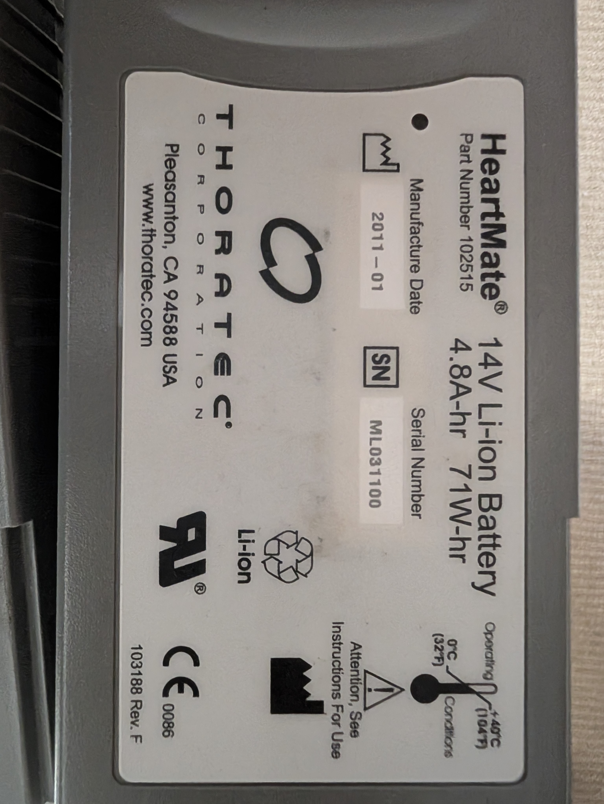
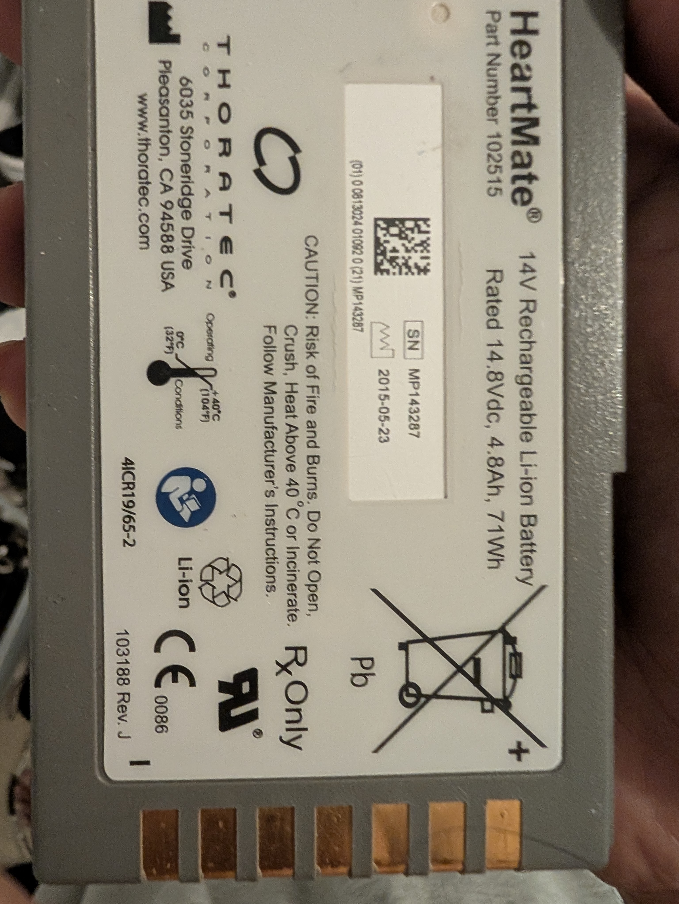
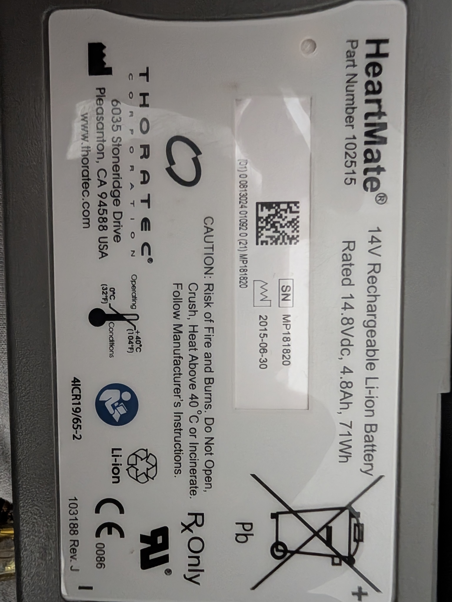
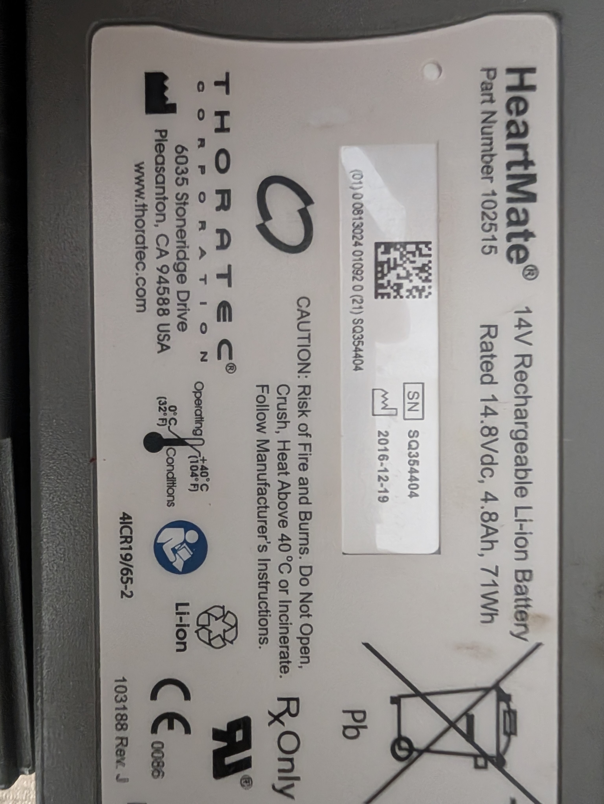

# Thoratec 102515 (14V Li-Ion Pack) — Reverse Engineering & Bench Log

> **SAFETY NOTICE:** All measurements, electrical sweeps, and destructive teardowns documented here are conducted exclusively on expired, decommissioned, non-clinical surplus hardware on an isolated workbench.

## 1. Confirmed Bench Hardware Inventory

### Surplus Locked-Out `Thoratec 102515` Packs (`0.000V` External Baseline)

| Unit | Serial Number | Mfg. Date | Label Revision | IEC Code | Rated Specs | Bench Role / Notes |
| :--- | :--- | :--- | :--- | :--- | :--- | :--- |
| **Donor 1** | `MP181820` | `2015-06-30` | `103188 Rev. J` | `4ICR19/65-2` | `14.8Vdc`, `4.8Ah`, `71Wh` | Intact Reference (`Rev. J`, UDI DataMatrix, `Rx Only`) |
| **Donor 2** | `SQ354404` | `2016-12-19` | `103188 Rev. J` | `4ICR19/65-2` | `14.8Vdc`, `4.8Ah`, `71Wh` | Intact Reference (`Rev. J`, Dec 2016 batch — save for last) |
| **Donor 3** | `ML031100` | `2011-01` | `103188 Rev. F` | *(Omitted)* | `4.8A-hr`, `71W-hr` (`14V` label) | **Primary Teardown Target** (oldest `Rev. F` pack; lowest stored energy) |
| **Donor 4** | `MP143287` | `2015-05-23` | `103188 Rev. J` | `4ICR19/65-2` | `14.8Vdc`, `4.8Ah`, `71Wh` | Intact Reference (`Rev. J`, May 2015 batch) |

- **Cell Chemistry Note:** `4ICR19/65-2` confirms `8x 18650 ICR` (Lithium Cobalt Oxide) cells in a `4S2P` layout. Keep rotary seam cuts **< 1.5 mm** and finish separation with vise pressure and plastic/ceramic spudgers.
- **Live Reference Packs:** Charged `103188 Rev. L` packs used for active DC pinout sweeps.
- **Replacement 21700 Cells on Hand:** `20x Samsung INR21700-50G` (`SAMSUNG SDI 2M32`, `3.518V` resting shipping voltage logged).
- **Current Multimeter:** `Commercial Electric BMM-8132R`.

---

## 2. Bench Hardware Reference Photos

*(Click any photo to view full resolution.)*

| Donor 3 — `ML031100` (`Rev. F`) | Donor 4 — `MP143287` (`Rev. J` & 7-Pad Array) |
| :---: | :---: |
|  2011-01 • Primary Teardown Target |  2015-05-23 • 7-Pad Connector View |
| **Donor 1 — `MP181820` (`Rev. J`)** | **Donor 2 — `SQ354404` (`Rev. J`)** |
|  2015-06-30 • Intact Reference |  2016-12-19 • Intact Reference |
---

## 3. Verified 7-Pad Gold Edge Connector Pinout

*Pad numbering runs from top (`+`, Pad 1) to bottom (`-`, Pad 7) looking directly at the gold edge contact array.*

| Pad # | Housing Marking | Dead Donors (`Rev. F`/`J`) | Live `Rev. L` (vs. Pad 1 `+`) | Live `Rev. L` (vs. Pad 7 `-`) | Verified Function |
| :---: | :---: | :---: | :---: | :---: | :--- |
| **1** | `+` | `0.000V` | `0V` (Ref) | `15–16V` | Main **`PACK+`** (A) |
| **2** | *(Unmarked)* | `0.000V` | `0V` | `15–16V` | Paralleled **`PACK+`** (B) — **Confirmed** |
| **3** | *(Unmarked)* | `0.000V` | `11V` | **`3V`** | **Active ~3.3V logic / sense / wake rail** (biased by BMS even undocked) |
| **4** | *(Unmarked)* | `0.000V` | `9V` | **`0V`** | Passive / pulled-down line (matched pair with Pad 5 — likely SMBus `SCL` / `SDA`) |
| **5** | *(Unmarked)* | `0.000V` | `9V` | **`0V`** | Passive / pulled-down line (matched pair with Pad 4 — likely SMBus `SCL` / `SDA`) |
| **6** | *(Unmarked)* | `0.000V` | `15–16V` | `0V` | Paralleled **`PACK-`** (A) — **Confirmed** |
| **7** | `-` | `0.000V` | `15–16V` | `0V` (Ref) | Main **`PACK-`** (B) |

### Multimeter Sweep Videos (`Commercial Electric BMM-8132R`, DC Voltage `V⎓`)

- **[DC Voltage – B+ Reference (YouTube Short)](https://www.youtube.com/shorts/Sw9LA8gSSbk):** Red probe held on Pin 1 (`+`), black probe sweeping Pins 2–7.
- **[DC Voltage – B- Ground Reference (YouTube Short)](https://www.youtube.com/shorts/rLPMEAEhzhc):** Black probe held on Pin 7 (`-`), red probe sweeping Pins 6–1.

---

## 4. Multimeter Measurement Caveats (`Commercial Electric BMM-8132R`)

1. **`1V` DC Display Resolution:** Whole-volt display cannot accurately audit individual `4S2P` cell-bank voltages during teardown. Upgrade to a `0.01V` (`20V DC`) meter before Phase 3 internal cell audits.
2. **`2kΩ` Resistance Ceiling:** Standard `10kΩ` NTC thermistors or pull-down resistors read over-range (`OL` / `1`).

---

## 5. Phase 2 → Phase 3 Action Checklist

- [ ] **Dead-Pack Continuity & Diode Check (`ML031100`):** Verify `0Ω` bridging on `Pads 1↔2` and `Pads 6↔7`; diode-check `Pads 3, 4, 5` to `Pad 7` to confirm ESD clamps.
- [ ] **Destructive Teardown (`ML031100`, 2011 `Rev. F`):** Split ultrasonic seam (<1.5 mm score), measure internal `4S2P` bank voltages (`B-`→`B1`→`B2`→`B3`→`B+`), photograph BMS PCB top/bottom traces, and identify TI fuel-gauge IC (`bq20zxx`/`bq40zxx`), secondary protector (`bq294xx`), 3-terminal chemical fuse, and NTC placement.
